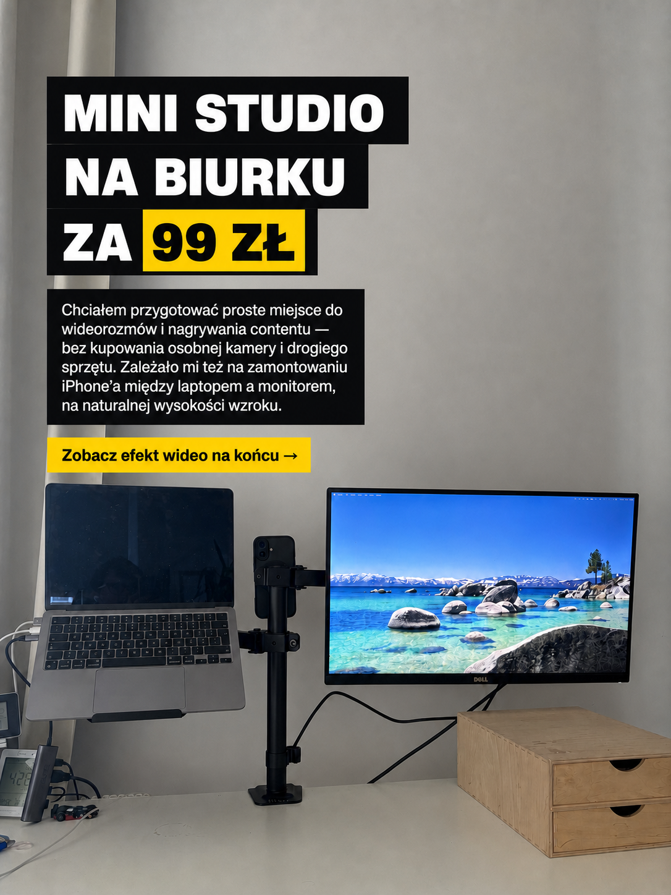
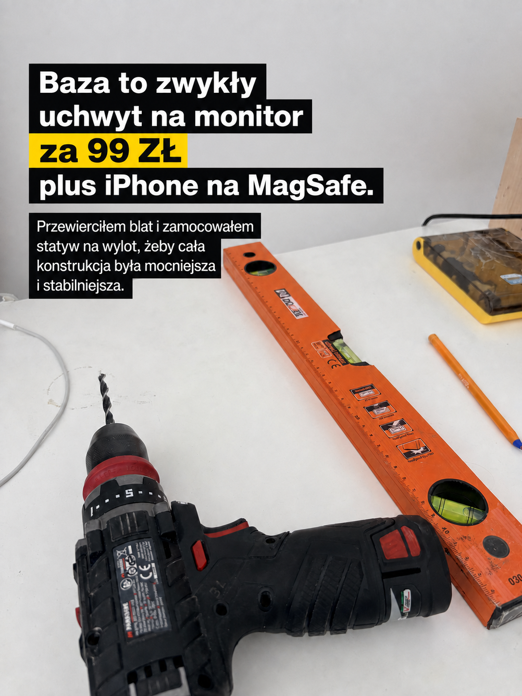
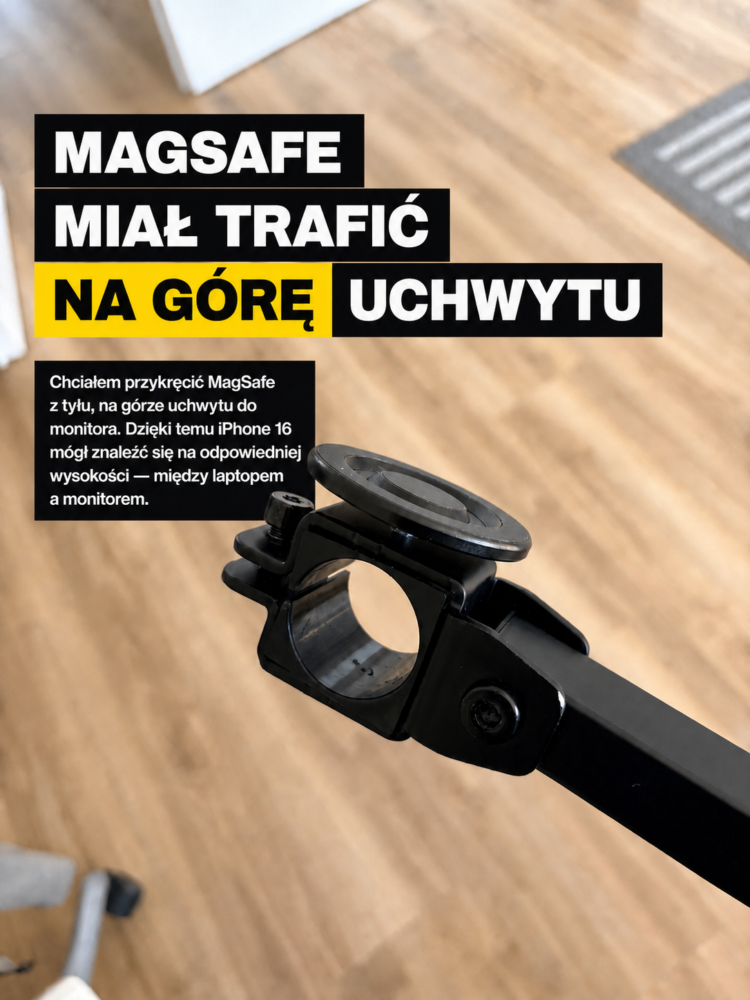
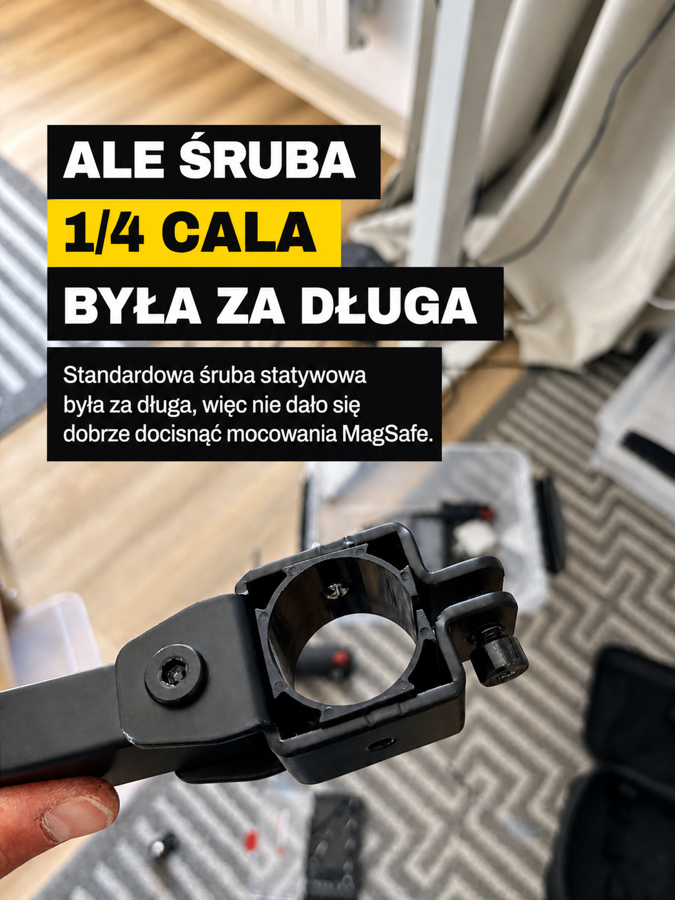
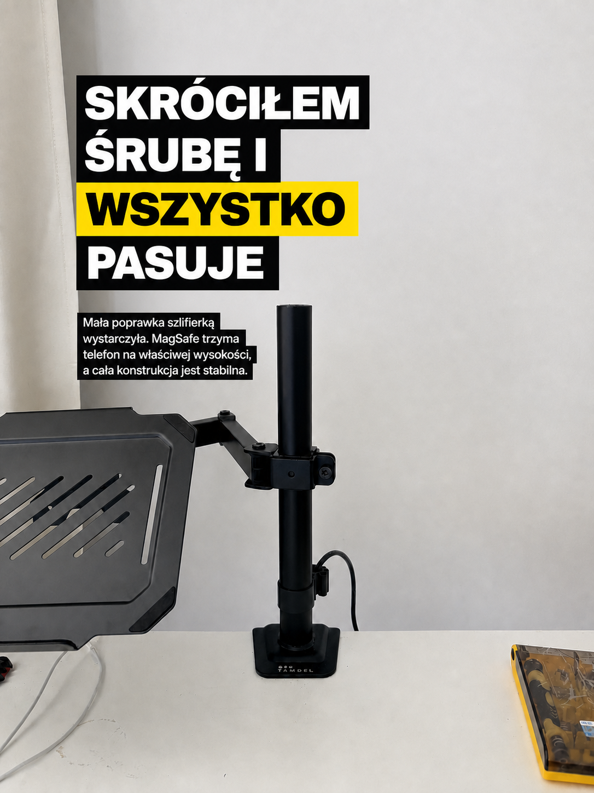

Tworzenie treści od zawsze było czymś, co mnie interesowało. Wraz z rozwojem technologii mamy dostęp do coraz większej ilości wiedzy, ale jednocześnie coraz bardziej potrzebujemy treści jakościowych — takich, które nie tylko przyciągają uwagę, lecz przede wszystkim przekazują coś wartościowego.

Coraz więcej jest też wideorozmów, spotkań online i okazji do nagrywania. Dlatego postanowiłem przygotować sobie na biurku proste mini studio. Chciałem stworzyć wygodne miejsce do rozmów i nagrywania bez kupowania osobnej kamery oraz drogiego sprzętu.

## Założenie: wykorzystać to, co już mam

Punktem wyjścia był iPhone 16. Jego kamera daje już wystarczająco dobry obraz, a dzięki funkcji Continuity Camera może działać jako kamera dla komputera.

Problemem nie była więc jakość obrazu, ale ustawienie telefonu. Chciałem umieścić go między laptopem a monitorem, na naturalnej wysokości wzroku. Dzięki temu podczas rozmowy nie muszę patrzeć wyraźnie w górę ani w bok, a spojrzenie pozostaje blisko ekranów, na których pracuję.

Cały zestaw miał być również:

- niedrogi,
- stabilny,
- szybki w uruchomieniu,
- możliwie prosty,
- oparty na sprzęcie, który już mam.

## Bazą został uchwyt na monitor za 99 zł

Kupiłem zwykły uchwyt na monitor za 99 zł. Zamiast korzystać z mocowania zaciskowego, przykręciłem go przelotowo do blatu. Wymagało to przewiercenia biurka, ale dzięki temu cała konstrukcja jest mocniejsza i stabilniejsza.

Na jednym ramieniu znajduje się podstawka pod laptopa, na drugim monitor, a pionowy element uchwytu wykorzystałem jako bazę do zamontowania telefonu.

## MagSafe na górze uchwytu

Telefon miał znaleźć się dokładnie pomiędzy ekranami, dlatego na górze uchwytu postanowiłem zamontować mocowanie MagSafe. iPhone może być dzięki temu zakładany i zdejmowany w kilka sekund, bez dodatkowych klamer.

Do połączenia użyłem standardowej śruby statywowej 1/4 cala. To popularny format stosowany w uchwytach fotograficznych i sprzęcie do nagrywania, więc wydawało się, że wszystkie elementy powinny po prostu do siebie pasować.

## Małe wyzwanie: zbyt długa śruba

Okazało się jednak, że śruba 1/4 cala była za długa. Nie dało się przez to dobrze docisnąć mocowania MagSafe do uchwytu.

Rozwiązanie było proste: skróciłem śrubę szlifierką. Ta niewielka poprawka wystarczyła, żeby mocowanie pasowało, MagSafe trzymał telefon na właściwej wysokości, a cała konstrukcja pozostała stabilna.

## Mój aktualny zestaw

Gotowe mini studio składa się z kilku prostych elementów:

- iPhone 16 jako kamera przez Continuity Camera,
- laptop i monitor jako dwa ekrany,
- uchwyt na monitor przykręcony przelotowo do blatu,
- mocowanie MagSafe połączone śrubą 1/4 cala,
- AirPodsy do dźwięku.

Najważniejsze jest dla mnie to, że telefon znajduje się na naturalnej wysokości wzroku. Nie zajmuje dodatkowego miejsca na biurku, szybko trafia na swoje miejsce i wykorzystuje kamerę, którą już mam.

## Pierwsze testy

Po pierwszych próbach zestaw działa tak, jak zakładałem. Obraz z iPhone’a wygląda dobrze, konstrukcja jest stabilna, a rozpoczęcie rozmowy lub nagrania nie wymaga każdorazowego rozstawiania sprzętu.

To nie jest profesjonalne studio zbudowane od zera. To prosty sposób na wykorzystanie dostępnych elementów i rozwiązanie konkretnego problemu niskim kosztem.

Tworzenie dobrych treści nadal wymaga pomysłu, wiedzy i pracy. Technologia może jednak usunąć część technicznych przeszkód. W tym przypadku wystarczył uchwyt za 99 zł, MagSafe, krótka praca przy biurku i sprzęt, który wcześniej już miałem.
